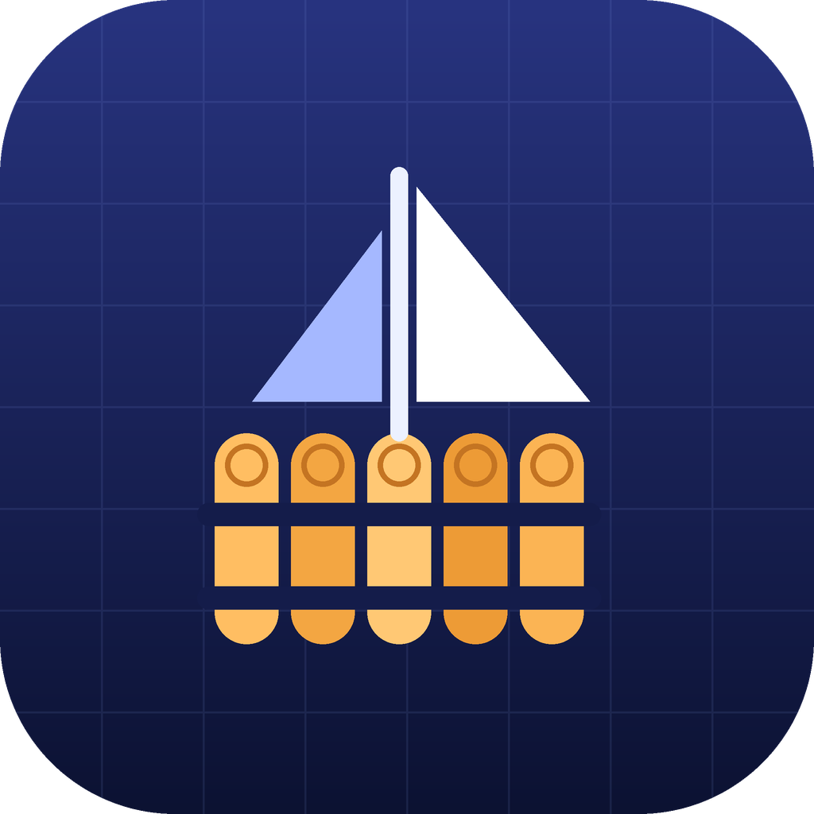

<p align="center"></p>

<h1 align="center">Raftly</h1>

<p align="center"><strong>Idea to production, with the judgment of a senior product and engineering organization.</strong><br>
An open-source <a href="https://code.claude.com">Claude Code</a> plugin. One command: <code>/raftly</code>.</p>

<p align="center">
  <a href="https://roszhan2684.github.io/raftly/">Website</a> ·
  <a href="https://roszhan2684.github.io/raftly/docs.html">Docs</a> ·
  <a href="#install">Install</a> ·
  <a href="examples/">Examples</a> ·
  <a href="https://github.com/roszhan2684/raftly/issues">Issues</a>
</p>

---

> Raftly is not a prompt that writes a roadmap. `/raftly` acts as the senior product and engineering organization
> around your project: it researches, decides, designs, architects, plans, verifies, remembers, and prepares the
> product for production.

You type:

```text
/raftly

I want to build a calculator mobile app and website.
```

Raftly works out what kind of product this is and which senior role should own each decision (product strategy,
design, architecture, security, SRE and more). It researches what is uncertain, decides what can be decided, asks you only
the genuine business questions, and records everything in a `.raftly/` folder in your repository. From that state it
produces a complete production blueprint:
- product, design, architecture and build documents
- decision records
- a dependency-ordered build graph, with one implementation prompt per capability
- a visual HTML blueprint and a slide deck

Later, `/raftly` builds the next unblocked capability, verifies it against recorded evidence, and tells you honestly
whether you're ready to launch.

## Install

Raftly installs into Claude Code once and works in every repository you open. There's no account, backend or API key.

**Option 1: plugin (recommended).** Inside Claude Code:

```text
/plugin marketplace add roszhan2684/raftly
/plugin install raftly@raftly
```

or from your terminal:

```bash
claude plugin marketplace add roszhan2684/raftly
claude plugin install raftly@raftly
```

**Option 2: try it without installing.**

```bash
git clone https://github.com/roszhan2684/raftly.git
claude --plugin-dir ./raftly
```

**Option 3: personal skill (no plugin system).** Copy the self-contained skill folder into your personal skills directory:

```bash
git clone https://github.com/roszhan2684/raftly.git
mkdir -p ~/.claude/skills && cp -R raftly/skills/raftly ~/.claude/skills/raftly
```

You'll need Claude Code and Python 3.9+ on your `PATH` (the scripts use only the standard library). Update the plugin with
`claude plugin update raftly@raftly`. If another plugin also defines `/raftly`, use the fully qualified `/raftly:raftly`.

## Use

| You type | Raftly does |
|---|---|
| `/raftly I want to build …` | **Greenfield.** Classify, research, product, design (2–3 real directions), architecture, build graph, blueprint package |
| `/raftly` (in a repo with `.raftly/`) | **Resume.** Shows where things stand and does the next recommended action, with no re-planning |
| `/raftly build next` | Implements the next unblocked capability, runs your tests, records real evidence, updates status |
| `/raftly review` | Reviews code or architecture against requirements and decisions; detects drift |
| `/raftly launch` | Production gate plus the "forgotten 20%" audit. Readiness comes from evidence only |
| `/raftly doctor` | Health diagnosis; says "no change" when nothing material is wrong |
| `/raftly explain why PostgreSQL?` | Answers from recorded decisions and the evidence graph |
| `/raftly handoff` · `replay` · `postmortem` | Onboarding doc · project history · incident record |
| "Use MongoDB instead of PostgreSQL." | Records your **founder override**, keeping Raftly's original advice and the consequences |
| "I hate rounded buttons." | A preference for *this* project. It never becomes a global rule |

Existing, half-built repository? `/raftly This app was half-built and the save button doesn't work.` starts **RECOVERY**.
Raftly inspects the code, records what exists as *current*, initialises its state **without touching your code**, and plans
verify → repair → extend. It never starts with a rewrite.

## How it works

1. **Orient.** `raftly context` reads the repo and `.raftly/` state, and infers the mode: greenfield, build, review, recovery,
   migration, scale, launch, operate, handoff or doctor.
2. **Research** what is external, current or uncertain. Anything that couldn't be verified is labelled "not verified" and never invented.
3. **Route** each decision to the senior-most role. There are 22 roles, defined in [`skills/raftly/core/roles.yaml`](skills/raftly/core/roles.yaml).
4. **Decide with authority levels.** *Auto* for routine choices, *Recommend* for important but reversible ones (recorded and
   continued), *Founder* for genuine business calls (asked, batched into one round).
5. **Record** ADRs (options, evidence, confidence, reversibility, consequences, revisit trigger), requirements, assumptions,
   risks, debt and dependencies. Deterministic Python scripts do this, so IDs and links stay consistent.
6. **Plan** the simplest architecture that meets the actual requirements, a build graph in dependency order, a feature spec
   per feature, and a self-contained prompt per capability.
7. **Build and verify.** Status moves PLANNED → IMPLEMENTED_UNVERIFIED → VERIFIED → COMPLETE. The scripts refuse VERIFIED,
   COMPLETE or PASS without recorded evidence.
8. **Launch honestly.** A production gate of 45 checks and a 29-item forgotten-20% audit, each applied only when it fits your
   product. A calculator gets 16 checks, a multi-tenant AI SaaS gets 42. "Not applicable" is a valid answer, and no evidence
   means no score.

The rules Raftly follows are in [`skills/raftly/core/CONSTITUTION.md`](skills/raftly/core/CONSTITUTION.md).

## What Raftly creates in your project

```text
.raftly/
├── state.yaml              mode, stage, blueprint status, execution, readiness, history
├── requirements.yaml  assumptions.yaml  risks.yaml  dependencies.yaml  experiments.yaml
├── build-graph.yaml        capabilities in dependency order (not a calendar)
├── evidence.yaml           requirement → feature → screen/API/table → test → metric, plus test results
├── gate.yaml               production gate + forgotten 20%
├── PRODUCT.md DESIGN.md DESIGN_SYSTEM.md ARCHITECTURE.md DATA_MODEL.md SECURITY.md
├── BUILD.md EXECUTIVE.md LAUNCH.md DECISIONS.md RESEARCH.md (+ GTM, PRIVACY, COMPLIANCE_READINESS, COST, MIGRATION, HANDOFF)
├── decisions/ADR-xxx-*.md  features/Fxxx-*.md  prompts/NNN-*.md
└── learnings/  learning-candidates/  debt/  postmortems/  research/  brand/
artifacts/
├── blueprint.html          visual blueprint (a view of .raftly/, never a source of truth)
└── deck.md                 12-slide deck source with speaker notes
```

Only relevant files are created. Everything is plain Markdown and YAML: review it, diff it, commit it with your project.

## Examples

Two complete outputs, generated with the Raftly engine:

| Example | Prompt | Shows |
|---|---|---|
| [**Tally**](examples/calculator/) ([blueprint](https://roszhan2684.github.io/raftly/examples/calculator.html)) | "I want to build a calculator mobile app and website." | Client-only; exact decimal maths; three design directions; calculator semantics; 29 server checks not applicable |
| [**SalesLens**](examples/b2b-ai-saas/) ([blueprint](https://roszhan2684.github.io/raftly/examples/b2b-ai-saas.html)) | "Build a B2B AI sales coaching platform…" | Tenancy with row-level security, AI eval gate, billing and metering, consent and compliance readiness, open pricing decision |

Walkthroughs: [calculator](docs/walkthrough-calculator.md) · [B2B SaaS](docs/walkthrough-b2b-saas.md).

## Learning without poisoning itself

| Level | Scope | Written by |
|---|---|---|
| L1 project memory | `.raftly/learnings/`, this project only | Raftly, immediately |
| L2 pattern candidates | `.raftly/learning-candidates/`, evidence collection | Raftly, when the firewall allows |
| L3 Raftly core | this repository | maintainers only, via reviewed PR |

The **Learning Firewall** classifies each observation as REJECT, PROJECT_ONLY, CANDIDATE or CORE_PROPOSAL. Preferences always
stay project-only. Raftly never modifies the installed plugin. See [docs/learning-model.md](docs/learning-model.md).

## Privacy

**Raftly has no required hosted backend and does not send project learnings to a Raftly server by default.** There is no
telemetry and no account. Everything lives in your repository. Research uses whatever web tools your Claude session already
has. See the [privacy policy](https://roszhan2684.github.io/raftly/privacy.html).

## Limitations

- Results depend on the model and on the tools available in your Claude session.
- Evidence links are recorded explicitly. Automatic code tracing (AST topology, contract tracing) is planned for v0.2.
- The behavioural evals (`claude plugin eval`) need Claude credentials and aren't run in CI. CI runs the deterministic tests and graders.

## Disclaimer

**Raftly does not replace professional legal, compliance, security, accessibility, or regulatory review. Raftly provides
engineering/product readiness analysis and evidence-based guidance.** It never certifies a product as compliant or secure.

## Development

```bash
python3 -m unittest discover -s tests -t .       # tests
python3 scripts/check_release.py                 # release checks (add --release for the public-release gate)
python3 evals/grade.py --examples                # deterministic evals on the examples
python3 skills/raftly/scripts/engine.py --help   # the engine the skill drives
claude plugin validate --strict .                # official manifest validation
claude --plugin-dir .                            # run the plugin locally
```

Repository map: [docs/architecture.md](docs/architecture.md) · evals: [evals/README.md](evals/README.md) · releasing:
[docs/releasing.md](docs/releasing.md) · compatibility: [docs/compatibility.md](docs/compatibility.md) · website source: [`site/`](site/).

## Contributing

External code contributions are not accepted yet. Issues and feedback are welcome. See [CONTRIBUTING.md](CONTRIBUTING.md).
Security reports: [SECURITY.md](SECURITY.md).

## Legal

Raftly source code and original documentation are protected by applicable copyright law and are licensed only under the terms
in this repository's [LICENSE](LICENSE) file (Apache License 2.0). © 2026 Roszhan Raj Meenakshi Sundhresan. Raftly and related
branding may be protected separately under trademark law, and formal trademark clearance is still pending. Apache-2.0 does not
grant trademark rights, and the license does not grant rights to imply endorsement or official affiliation. Raftly is an
independent project, not affiliated with or endorsed by Anthropic. Claude and Claude Code are trademarks of Anthropic, PBC.
Third-party components remain subject to their own licenses ([THIRD_PARTY_NOTICES.md](THIRD_PARTY_NOTICES.md)). See also
[NOTICE](NOTICE) and [docs/PROVENANCE.md](docs/PROVENANCE.md).

## License

[Apache License 2.0](LICENSE)
