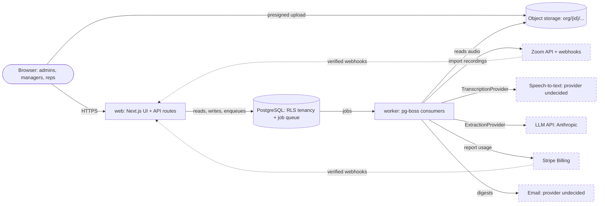
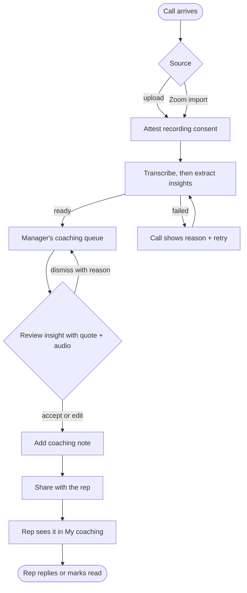
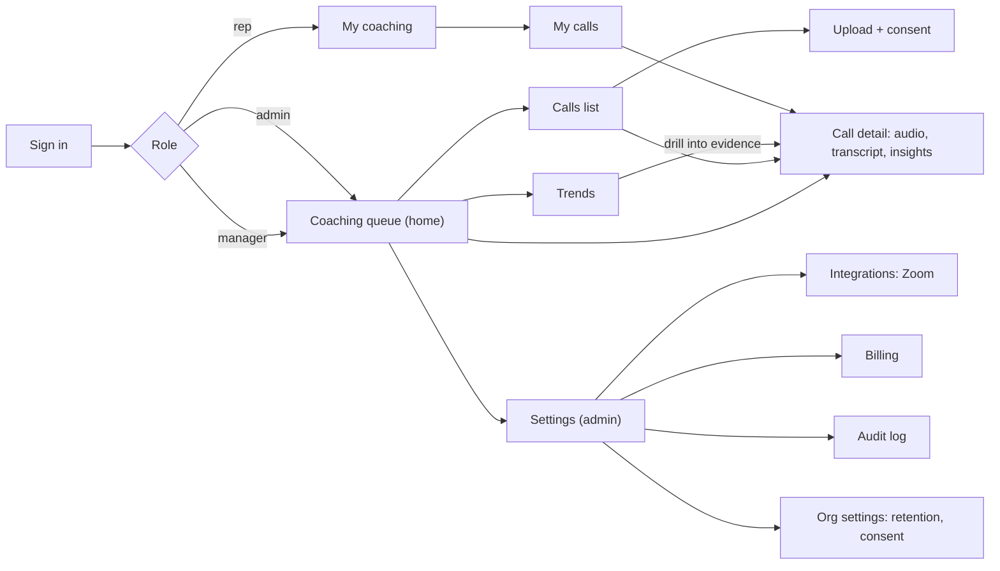
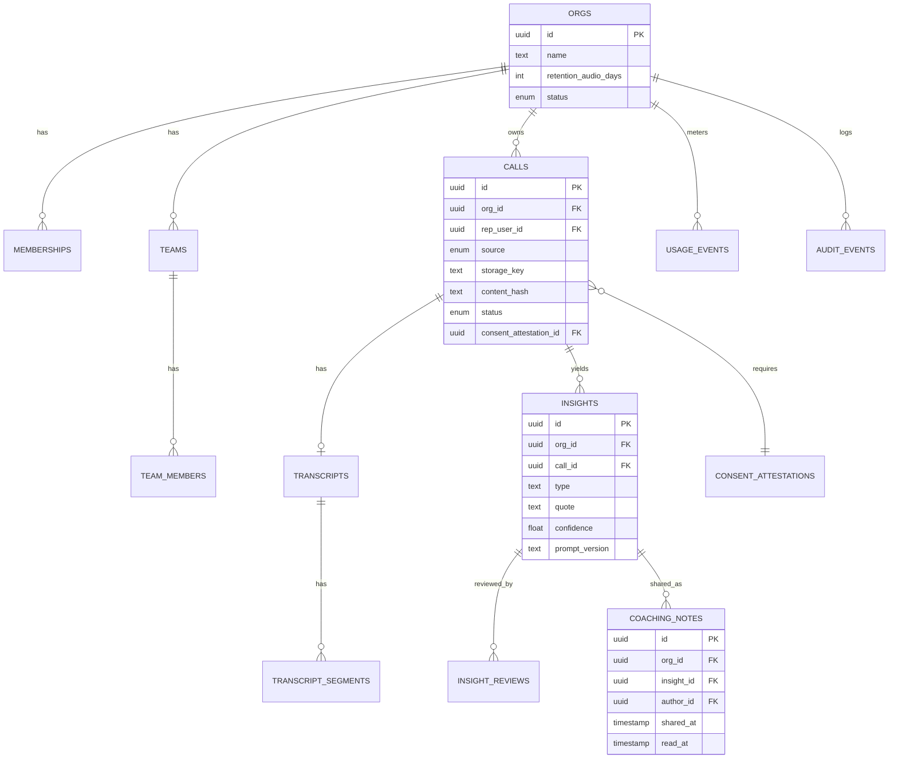
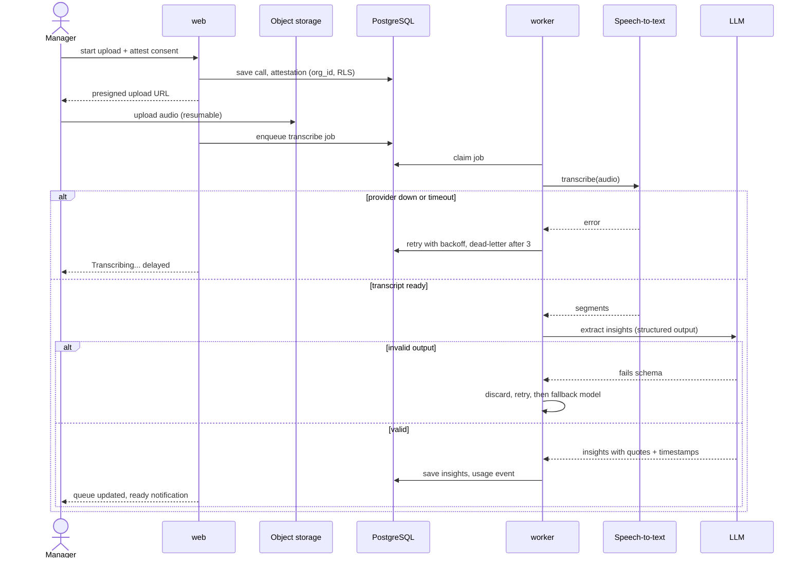

# Product Diagrams — SalesLens

These diagrams render as pictures on GitHub and in most Markdown viewers that support Mermaid. Each one is
drawn from a recorded decision; nothing here goes beyond ARCHITECTURE.md, DESIGN.md, DATA_MODEL.md and the ADRs.
The transcription provider and the email provider are not chosen yet and are labelled that way.

## 1. System architecture
A TypeScript modular monolith (ADR-001): a `web` process and a `worker` process share the domain modules.
PostgreSQL with row-level security holds all relational data and the job queue (ADR-002, ADR-005). Audio
lives in object storage under per-tenant prefixes (ADR-004). AI calls go through provider interfaces
(ADR-006, ADR-007) and are gated by the eval harness (ADR-008). Zoom is the only integration (ADR-011).
Everything runs in one cloud region; dashed boxes are third parties, outside our trust boundary.

## 2. User flow
The manager triage flow from DESIGN.md, from a call arriving to a rep reading shared coaching, including
the processing-failure branch.

## 3. Screen map and navigation
Direction A, coaching queue first (ADR-009). Managers land on the queue; reps land on My coaching;
settings screens are admin-only.

## 4. Data model
Shared schema with `org_id` on every tenant table and RLS policies (ADR-002, DATA_MODEL.md). Billing and
governance tables are summarised.

## 5. Critical path sequence
Upload to insights: the path every customer depends on. Retries with backoff and a dead-letter queue for
the speech provider; invalid AI output is discarded, not shown (ARCHITECTURE.md failure behaviour).

