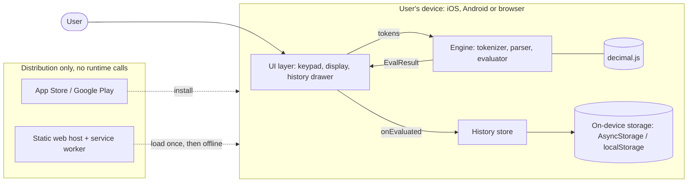
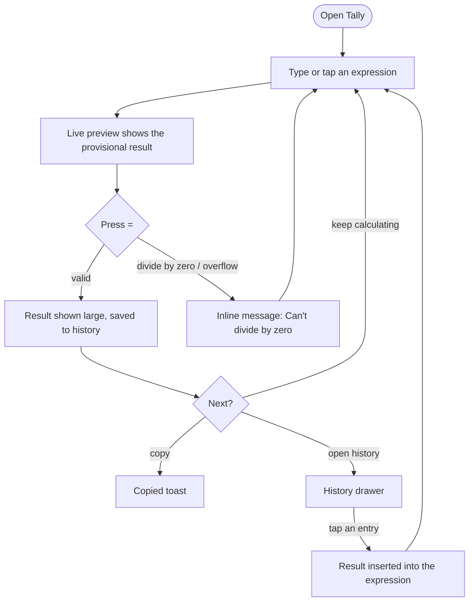
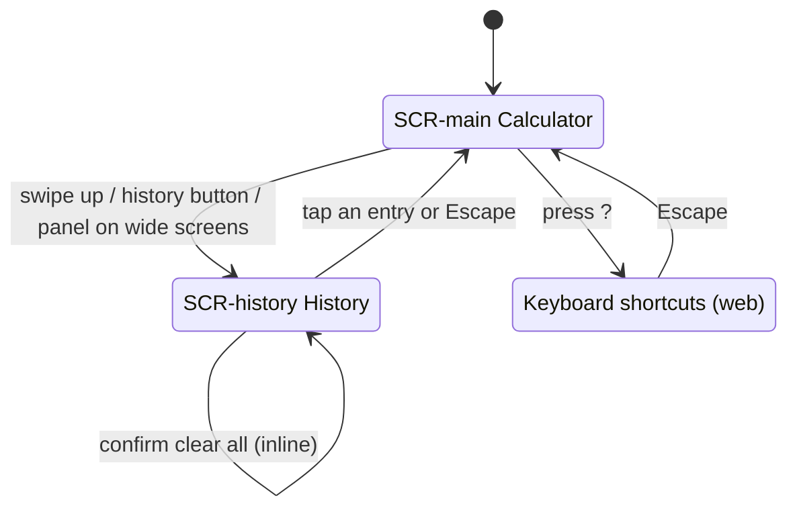
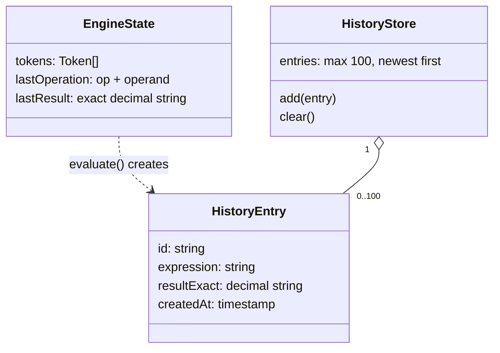
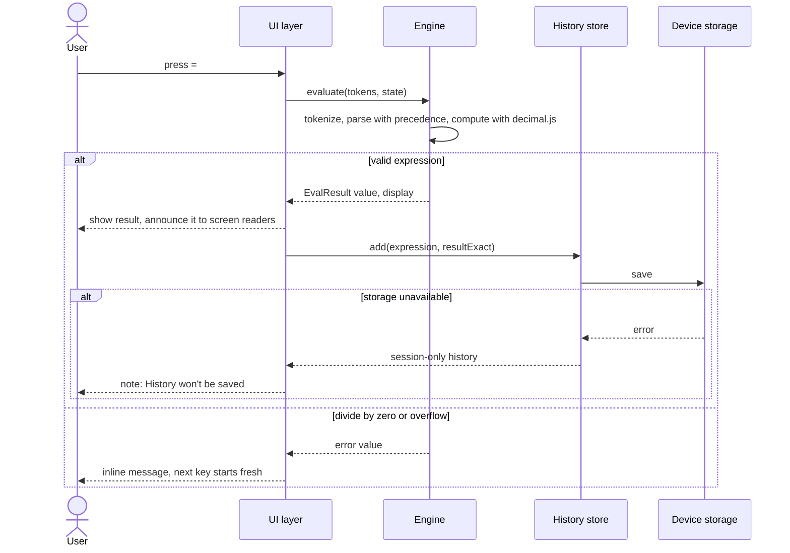

# Product Diagrams — Tally

These diagrams render as pictures on GitHub and in most Markdown viewers that support Mermaid. Each one is
drawn from a recorded decision; nothing here goes beyond ARCHITECTURE.md, DESIGN.md and the ADRs.

## 1. System architecture
A client-only app (ADR-001): one Expo + React Native Web codebase (ADR-004) runs on the phone or in the
browser. All maths happens in a pure TypeScript engine (ADR-002) with decimal.js (ADR-003). History stays on
the device. There are no runtime services; stores and the static web host only distribute the app.

## 2. User flow
The three key flows from DESIGN.md: calculate, reuse a result from history, copy. Errors stay inline,
never in a dialog.

## 3. Screen map and navigation
One screen plus a history surface (DESIGN.md, ADR-005). History is a bottom sheet on phones and a side
panel at 900 px and wider; the shortcuts dialog exists on the web only.

## 4. Data model
No server and no personal data (blueprint data section: NOT_APPLICABLE). The only data is the engine
state and up to 100 history entries on the device (F001, F003).

## 5. Critical path sequence
Pressing `=`: the most important path in the product. Exact maths, display-only rounding, and an inline
error instead of a crash (ARCHITECTURE.md failure behaviour, ADR-006).

