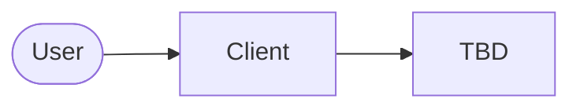
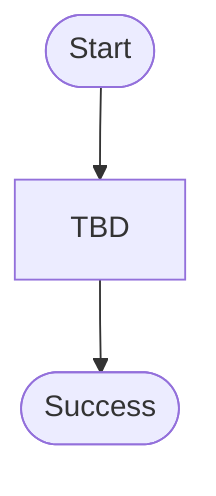
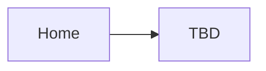
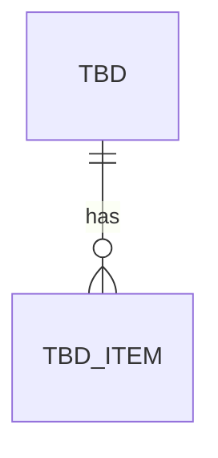
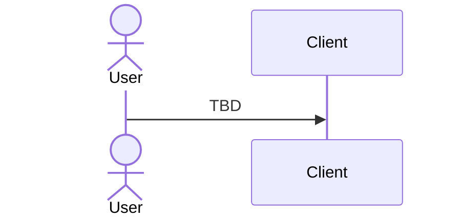

# Product Diagrams — {Product}

<!-- Owner: Principal Software Architect, with the Head of Product Design for sections 2 and 3.
Five diagrams, all Mermaid, all drawn from recorded decisions (cite ADR ids). Keep each one readable:
roughly 5-15 boxes. If a diagram genuinely does not apply, replace its block with
"Not applicable: <reason>" (at least one diagram must apply). Guidance: references/diagrams.md. -->

These diagrams render as pictures on GitHub and in most Markdown viewers that support Mermaid.

## 1. System architecture
TBD — what the parts are, where each runs, external services and trust boundaries (ADR-xxx).

## 2. User flow
TBD — the primary journey from first visit to success, with the main error branch.

## 3. Screen map and navigation
TBD — screens and how the user moves between them (matches DESIGN.md).

## 4. Data model
TBD — entities, keys and relationships (or the client state model when there is no database).

## 5. Critical path sequence
TBD — the most important request end to end, including the failure path.

